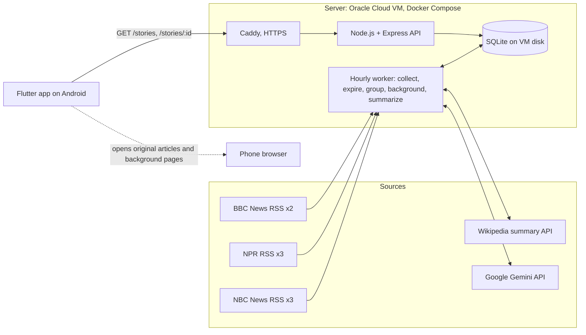

# My News

An AI-powered news service built for CS 403. News organizations often cover the same event, but readers have to visit several sites to compare coverage and get background. My News groups coverage of the same event into one story, with buttons for each publisher's original reporting, background links, and clearly labeled AI analysis.

- **Deployed API:** https://163-192-125-189.sslip.io (try [`/stories`](https://163-192-125-189.sslip.io/stories) or [`/health`](https://163-192-125-189.sslip.io/health))
- **Android app:** `flutter_application_1/build/app/outputs/flutter-apk/app-release.apk` (build steps below)
- **Version:** 1.0.0 beta (October 2026)

| Document | Contents |
|---|---|
| [docs/spec.md](docs/spec.md) | The assignment |
| [docs/api.md](docs/api.md) | API reference |
| [docs/collection.md](docs/collection.md) | Feeds, normalization, duplicate prevention, publication-date rule, schedule, failure handling |
| [docs/grouping.md](docs/grouping.md) | Grouping method, tuning, live examples, failure modes |
| [docs/background.md](docs/background.md) | How background links are chosen |
| [docs/ai.md](docs/ai.md) | Prompts, model configuration, validation, reuse, quotas, manual review of 3 summaries |
| [docs/verification.md](docs/verification.md) | Required verification checks with actual results |
| [docs/deploy.md](docs/deploy.md) | Deploying the server |
| [docs/demo-checklist.md](docs/demo-checklist.md) | Demo script and release test log |
| [docs/ai-reflection.md](docs/ai-reflection.md) | AI development reflection |
| [flutter_application_1/README.md](flutter_application_1/README.md) | Building and running the app |

## Architecture



Text version:

```
RSS feeds ─┐
Wikipedia ─┼─> hourly worker (collect → expire → group → background → AI) ─> SQLite ─> API ─> HTTPS ─> Flutter app
Gemini ────┘                                                                                     └─> browser (links)
```

**The server does all the work; the app only reads.** Collection, grouping, background lookup and AI generation run on the server on a schedule. Opening the app, refreshing, or pressing an AI button only reads stored results, so every reader shares the same work. API keys exist only in the server's `.env`.

## Service choices

| Part | Choice | Why |
|---|---|---|
| Server | Node.js 24 + TypeScript, Express 5 | Familiar, fast to build; the built-in `node:sqlite` means no native packages to compile |
| Database | SQLite file on the VM's disk | Persistent across restarts and rebuilds (verified), no separate database service |
| Hosting | Oracle Cloud Always Free VM (ARM64, Ubuntu), Docker Compose, Caddy (Let's Encrypt HTTPS) | Free, always on (so the hourly job runs without clients), real disk |
| News | RSS: NBC News, NPR, BBC News (8 section feeds) | Free, no keys, 3 distinct publishers. Fox News was used until October 20 and replaced by NBC News at the owner's request. CNN's feeds stopped in 2023. |
| Background | Wikipedia page-summary API | Free, no key, stable URLs and short descriptions |
| AI | Google Gemini `gemini-3.5-flash-lite` (free tier) | Free; 500 requests/day is enough for every multi-article story |
| App | Flutter 3.47 (Dart), Android | Required; same code could build for other platforms |

## Data model

| Table | One row per | Key columns |
|---|---|---|
| `articles` | Publisher article | `id` (hash of normalized URL), `url` (unique), `publisher`, `title`, `excerpt`, `published_at` (UTC), `published_at_source` (`feed` or `first_seen`), `story_id`, `story_match_json` |
| `stories` | Event | `id` (`s_` + founding article ID), `headline`, `updated_at` (latest article), `article_count`, `publisher_count`, `articles_hash`, `background_hash` |
| `story_summaries` | Story's AI analysis | `content_json`, `input_hash`, `input_article_ids`, `model`, `prompt_version`, `generated_at`, `last_error`, `last_error_retryable` |
| `background_resources` / `story_background` | Wikipedia page / story↔page link | `url`, `title`, `description`; `matched_term`, `rank` |
| `job_runs` / `job_feed_results` | Collection run / feed per run | Start and finish time, outcome, article counts, expiry and grouping counts; per-feed HTTP status and error |
| `ai_calls` | Model request | Model, prompt version, duration, ok/error, tokens (no article or summary text) |
| `wiki_lookups` | Looked-up name | 24-hour cache of Wikipedia results |

Deleting a story cascades to its summary and background links. Unused background resources are then deleted. Logs (`job_runs`, `ai_calls`) hold counts and errors only, never expired article text or summaries. Schema migrations are in [server/src/migrations.ts](server/src/migrations.ts).

## API

Public, read-only:
- `GET /stories`: story list, newest first, with headline, latest time, publisher count and publishers, plus `lastSuccessfulCollectionAt`.
- `GET /stories/{id}`: the story with articles grouped by publisher, `background` links, and `ai` (overview, agreement, disagreement, uncertainties, perspectives, status, generation time, citations).

Admin endpoints (bearer token) trigger collection, background links or summaries and show the job and AI logs. Full reference: [docs/api.md](docs/api.md).

## How it works

- **Collection:** 8 RSS feeds every hour at :00 UTC.
  - URLs are normalized (tracking parameters removed), and the normalized URL is the unique key, so re-fetching updates rather than duplicates.
  - A missing or invalid publication date falls back to the first-seen time, which never moves forward.
  - Each feed is fetched and written separately, so one failure doesn't affect the others. Every run is logged.
  - Details: [collection.md](docs/collection.md).
- **Retention:** articles older than **168 hours by publication time** are deleted on every run, even if all feeds fail. The API applies the same cutoff when each request comes in, so expired articles disappear between runs too. Empty stories are deleted along with their summaries and background links.
- **Grouping:**
  - Two articles match when they were published within 72 hours of each other, their TF-IDF similarity is high enough, and they share at least 2 distinct concepts, at least 1 of them a name. One name counts once, so **one shared person or keyword can never merge two stories**.
  - A strict-majority check stops a broad roundup article from chaining unrelated events.
  - Story IDs never change. Tuned and checked by hand on live data: [grouping.md](docs/grouping.md).
- **Background:** Wikipedia pages for names that appear in 2+ of a story's articles, or multi-word names in its headline. Disambiguation pages and name lists are skipped, so there's never a guessed link. Details: [background.md](docs/background.md).
- **AI:**
  - Gemini writes an overview (agreement, disagreement, uncertainty) and perspectives only when the coverage supports them; otherwise it reports "Insufficient evidence for distinct perspectives".
  - Article text goes in as untrusted JSON data.
  - Output is validated: every statement must cite the story's own articles, and invented quotes and outlet-named perspectives are removed.
  - Each summary is generated once per set of input articles and stored. A summary that depends on an expired article is never shown.
  - Details: [ai.md](docs/ai.md).

## Setup

### Server (local development)

```bash
cd server
npm install
cp .env.example .env        # set ADMIN_TOKEN; add GEMINI_API_KEY for AI summaries
npm test                    # 74 tests
npm run dev                 # http://localhost:3000
```

Requires Node.js 22.13 or newer (24 LTS recommended). See [server/.env.example](server/.env.example) for every setting.

### Server (production)

Docker Compose with Caddy on the Oracle VM: [docs/deploy.md](docs/deploy.md). Redeploy:

```bash
cd ~/MyNewsApp && git pull && cd server && docker compose up -d --build
```

### Android app

```bash
cd flutter_application_1
flutter build apk --release
flutter install -d <device-or-emulator-id> --release
```

The API URL defaults to the deployed server. Override it with `--dart-define=API_BASE_URL=…`. One-time Windows setup (Developer Mode, Android Studio, emulator) is in [flutter_application_1/README.md](flutter_application_1/README.md).

## Operating costs and quotas

| Service | Cost | Limits | How we stay within them |
|---|---|---|---|
| Oracle Cloud VM | $0 (Always Free) | Free-tier ARM shape | One small container plus Caddy |
| RSS feeds | $0 | Publisher fair use | 8 requests per hour |
| Wikipedia API | $0 | Polite use with a descriptive User-Agent | Up to 40 stories per run, 24-hour cache |
| Gemini `gemini-3.5-flash-lite` | $0 (free tier) | 500 requests/day, 15/minute (per ai.dev, Oct 20, 2026) | Budget of 250 calls/day, counted per model; 6.5 s between calls; only stories with 2+ articles; each summary generated once and shared |
| Let's Encrypt (via Caddy) | $0 | Certificate rate limits | One certificate, renewed automatically |

Total: **$0 per month**. Google may use free-tier Gemini inputs to improve its products. Our inputs are public headlines and excerpts.

## Known limitations

- **Demo uses the emulator, not a phone:** no Android phone was available. The developer has an iPhone, which can't run a Windows-built Flutter app, and Phone Link can't mirror iPhones. The release APK runs in the Android Studio emulator.
- **AI only covers multi-article stories:** to stay within the free Gemini quota, single-source stories show a quota message instead.
- **AI input is excerpts only:** it sees headlines and feed excerpts, not full articles, and every analysis says so. Summaries can still miss context; see the [manual review](docs/ai.md#manual-review-of-three-summaries).
- **Grouping is heuristic:** it can split one event when outlets word it differently, and stories never merge later. Details in [grouping.md](docs/grouping.md#where-it-can-be-wrong).
- **Background coverage is partial:** about 40–55% of stories have links; the rest honestly show "No background resource available".
- **Headlines carry one outlet's framing:** each story's headline is one publisher's original title.
- **No offline cache** (it was optional). Without a connection the app shows a retry screen.

## Release notes: 1.0.0 beta

**Features**
- Top stories list:
  - one entry per story with headline, latest article time, publisher count and names, and an "AI analysis" tag when the story has stored analysis;
  - filters: All / With AI analysis / 2+ publishers, plus publisher chips;
  - refresh; loading, empty, error and "no matches" states.
- Story detail:
  - an overview: the AI overview (labeled), or the newest report's original excerpt (labeled);
  - **Original coverage** buttons only for publishers that covered the story, with a chooser for multiple articles;
  - **Background** links from Wikipedia;
  - **AI overview** and **AI perspectives** screens with citations, generation time and an excerpt-only disclosure.
- Server: hourly collection from 3 publishers, 7-day retention, automatic grouping, background links, shared AI summaries with honest statuses.

**Known minor issues**
- Long AI overviews push the button groups below the fold on small screens; you have to scroll.
- On a fresh emulator, the first link opens Chrome's welcome screen.
- A story's AI analysis shows "outdated" (still visible, flagged) for up to an hour after new coverage joins, until the next hourly run regenerates it.

**Reporting problems:** beta testers can open an issue at https://github.com/GDeLong33/MyNewsApp/issues with the story headline, what they expected, and a screenshot.

## Defect log

| ID | Severity | Defect | Steps to reproduce | Status | Fix verified by |
|---|---|---|---|---|---|
| D1 | Critical | Deployed server unreachable over HTTPS | `curl https://…/health` timed out | Fixed | The Oracle security list had ports 80/443 as *source* ports; changed to destination ports. `/health` returned 200. |
| D2 | Major | Grouping merged unrelated stories ("Trump's economy" vs. "US economy under Trump"; two "Former US ambassador" stories; two Ukraine stories) | Score all live article pairs with the first rule (similarity ≥ 0.20, 2 concepts, 1 name) | Fixed | Job titles removed from names, plus a stricter rule for similarity 0.20–0.35. Re-scored live pairs, all three rejected; tests. |
| D3 | Major | A roundup article chained a DOJ story and a Russia story into one group | Live grouping run: "Morning news brief" joins the DOJ story, then the Russia article joins through it | Fixed | Joining requires similarity with a strict majority of members. Re-ran live: separate stories; chaining test. |
| D4 | Major | All AI calls failed: `gemini-2.5-flash` "no longer available to new users" | Deploy, check `/admin/ai-calls` (40 × HTTP 404) | Fixed | Switched model; HTTP 400/401/403/404 now stop the batch after one call; `retryFailed` option. Live summaries generated. |
| D5 | Major | AI summaries stopped: free quota of 20 requests/day exhausted | Run summary passes on `gemini-3.8-flash` | Fixed | Moved to `gemini-3.5-flash-lite` (500/day), budget of 250/day counted per model, multi-article stories only. 33 summaries live, 0 failed. |
| D6 | Minor | Gemini 503 overload and timeouts marked stories failed for 2 hours | Live calls during high demand | Fixed | One in-batch retry, 120-second timeout, no back-off for temporary errors, batch stops after 3 in a row. Tests. |
| D7 | Major | AI added facts not in the input ("former President", "Democratic Representative"), merged separate critics into one statement, and leaked "(A1)" into text | [Manual review](docs/ai.md#manual-review-of-three-summaries) of Omar and France summaries | Fixed | Prompt versions .2 and .3, reference-ID stripping, regeneration on prompt change. Re-checked live: fixed. |
| D8 | Minor | Wrong background links ("Top Trumps" card game, "Violence", "Musk" → perfume, name-list pages) | First live background run | Fixed | Sentence-start rule, single words need 2+ articles, name lists skipped. Every link re-read on live data. |
| D9 | Minor (cosmetic) | Quota message said "Read the original coverage **below**", but the buttons are above it | Open a single-source story in the app | Fixed | Message changed. Server tests pass; deployed. |
| D10 | Minor | Release build couldn't open links on Android 11+ / couldn't reach the API | Release APK without INTERNET permission or a VIEW intent query | Fixed before first build | Manifest updated. Emulator: Open launches Chrome; Back returns to the same screen. |

No critical or major defects are open.
